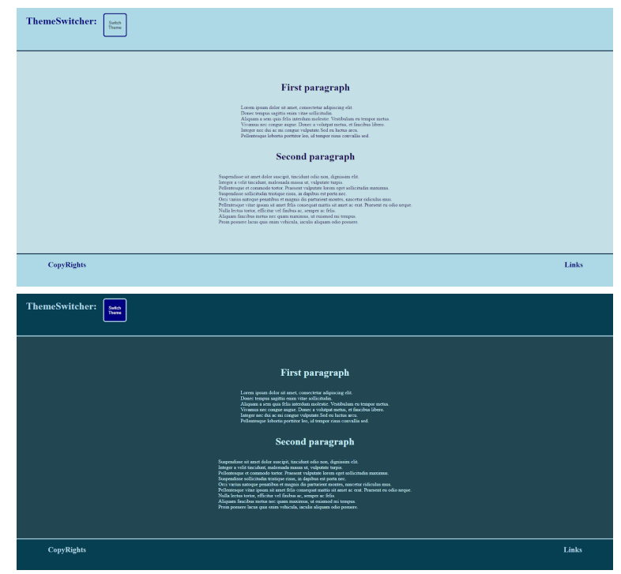

Задание 1
Создание приложения с переключением темы на сайте:

1. Создайте новый React-проект с помощью create-react-app. Подготовьте проект к работе.
2. Разделите интерфейс на три основных компонента: Header, MainContent и Footer.
3. В этом компоненте разместите заголовок вашего сайта. Установите место для ThemeSwitcher в углу
   заголовка.
4. Добавьте в MainContent пару параграфов с заголовками, которые будут варьироваться в стилях в
   зависимости от темы.
5. В Footer поместите копирайт и любую другую полезную информацию, которую желаете добавить.
6. Реализуйте кнопку или переключатель для смены темы. Используйте useState для управления активной
   темой (light или dark).
7. Создайте объект или используйте CSS переменные для определения цветов и стилей двух тем — светлой и
   темной. Реализуйте функционал в ThemeSwitcher, который изменяет состояние темы в родительском
   компоненте (App) при нажатии на переключатель.
   Задание 1
8. Передайте выбранную тему во все компоненты (Header, MainContent, Footer) через props.
9. В каждом компоненте используйте переданные props темы для определения стилей элементов (например,
   цвет текста, фона). Реализуйте изменение классов или стилей элементов на основании активной темы.
10. Добавьте необходимые CSS стили или модули для поддержки отображения светлой и темной темы.
    Убедитесь, что изменение темы динамично обновляет стили всех элементов.
11. Протестируйте приложение, переключая темы и наблюдая за корректным обновлением стилей всех
    компонентов. Проверьте реактивность интерфейса на разных устройствах и в различных браузерах.
    
    ===========================================================================================

    Задание 2
    Разработаем приложение на React для управления списком задач (to-do list), которое позволяет добавлять и
    удалять задачи:

12. В компоненте App инициализируйте состояние, которое будет хранить список всех задач.
13. Добавьте в компонент App кнопку для добавления новой задачи в список. Реализуйте функцию, которая
    будет обрабатывать событие нажатия на кнопку и добавлять новую задачу в состояние.
14. Создайте дочерний компонент, который будет отвечать за отображение отдельной задачи.
15. Добавьте функционал для очистки списка от задач по нажатию кнопки удаления.
16. Обеспечьте передачу данных о задачах из компонента App в дочерний компонент.
17. Убедитесь, что при рендеринге списка задач каждому элементу списка назначен уникальный ключ key.
18. Добавьте приложению модульные стили на ваш вкус.
    ○ app.module.css
    ○ task.module.css
19. Тестирование функциональности приложения. Проверьте работоспособность всех функций: добавление
    задач, удаление задач. Убедитесь, что UI корректно отображает изменения без ошибок или задержек.

import styles from '../styles/task.module.css'
function Task({text}) {
return (

 

 <h3 className={styles.title}>
 {text}
 </h3>
 

 );
}
export default Task;

Решение 2
import styles from '../styles/app.module.css'
import React, {useState} from 'react';
import Task from './Task';
function App() {
const [tasks, setTasks] = useState([
{ id: 1, title: "Задача номер 1" },
{ id: 2, title: "Задача номер 2" },
{ id: 3, title: "Задача номер 3" }
])
const addTask = () => {
const newTask = {
id: tasks.length + 1,
title: `Задача номер ${tasks.length + 1}`
};
setTasks(prevTasks => [...prevTasks, newTask])
}

const clearTasks = () => {
setTasks(prevTasks => [])
}
return (

 

 

 <button className={styles.buttonAdd} onClick={addTask}>Добавить задачу</button>
 <button className={styles.buttonClear} onClick={clearTasks}>Убрать</button>
 

 <h1 className={styles.h1}>Список задач:</h1>
 

 {tasks.map((task) => (
 <Task text={task.title} key={task.id} />
 ))}
 

 

 );
}
export default App;

Решение 2
.App{
display: flex;
flex-direction: column;
justify-content: center;
align-items: center;
}
.h1 {
color: rgb(0, 141, 141);
}
.buttonAdd {
background-color: rgb(33, 177, 177);
border: 2px solid rgb(80, 190, 226);
border-radius: 10px;
color: rgb(175, 226, 213);
height: 50px;
width: 200px;
margin-right: 20px;
}
Решение 2
.buttonClear {
background-color: rgb(122, 31, 77);
border: 2px solid rgb(163, 102, 131);
border-radius: 10px;
color: rgb(216, 200, 212);
height: 50px;
width: 200px;
}
Решение 2
.Task {
display: flex;
justify-content: center;
border: 3px solid rgb(83, 138, 135);
border-radius: 10px;
background-color: aquamarine;
max-width: 500px;
margin: 10px;
}
.title {
color: rgb(57, 112, 109);
