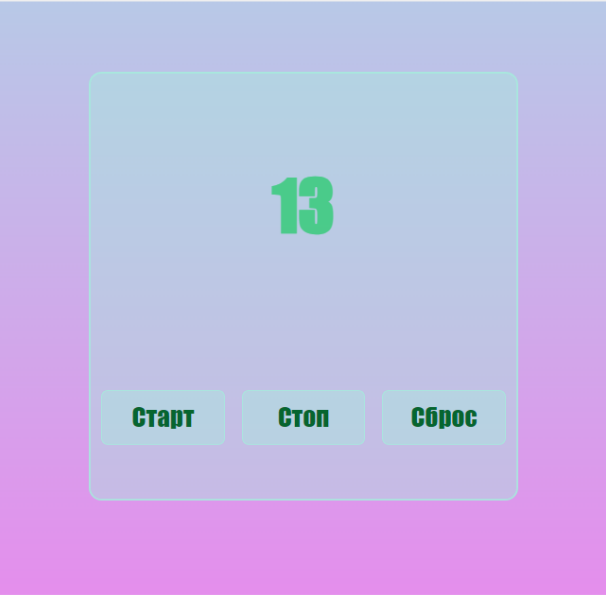
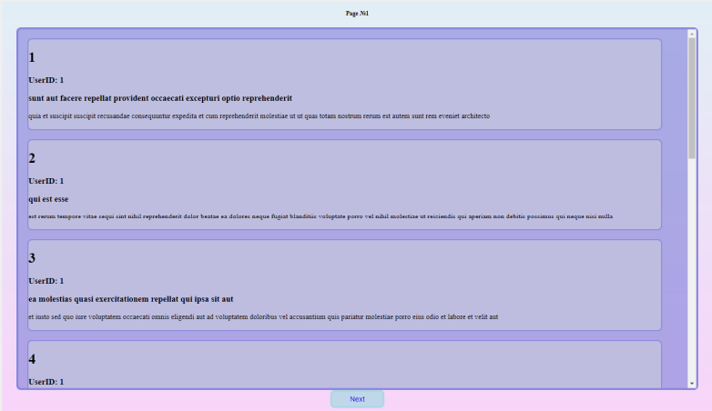

React Практикум 6

Задание 1:

1. Подготовка среды
   ○ Создайте новый проект React при помощи Create React App.
   ○ Создайте необходимые файлы для вашего проекта: App.js, Timer.jsx.
   Также создайте папку styles для CSS модулей.
2. Настройка стилей
   ○ Создайте CSS модуль для компонента Timer (Timer.module.css).
3. Работа над App.js
   ○ Импортируйте стили и компонент Timer.
   ○ Вставьте компонент Timer в качестве дочернего элемента в JSX
   разметку App.js.
4. Создание компонента Timer.jsx
   ○ Импортируйте необходимые зависимости для работы с React и CSS
   модуль.
   ○ Используйте useState для управления текущим временем таймера и
   его активным состоянием.
   ○ Создайте useEffect, который будет обрабатывать логику таймера,
   активируя его работу при включенном состоянии и останавливая при
   выключении.
   ○ Определите функцию для начала отсчета времени, которая изменяет
   активное состояние таймера.
   ○ Определите функцию для остановки таймера и функцию для сброса
   таймера до начального состояния.
   ○ Отрендерите кнопки управления таймером (Старт, Стоп, Сброс) и блок
   для отображения времени.
5. Стилизация компонентов
   ○ Примените стилизацию к компоненту Timer для улучшения визуального
   вида.
6. Тестирование функциональности
   ○ Убедитесь, что таймер правильно начинает, останавливается и
   сбрасывается.
   ○ Проверьте, что интерфейс является отзывчивым и корректно
   отображает изменение времени.
   ○ Проверьте, что стили корректно применяются и элементы приложения
   не наслаиваются друг на друга.
   

Задание 2: Создание приложения "Лента постов" с использованием Axios и React

1. Подготовка среды
   ○ Создайте новый проект React при помощи Create React App.
   ○ Установите axios: npm install axios.
   ○ Создайте необходимые файлы и папки:PostList.jsx, Post.jsx.
2. Создание стилей
   Для каждого компонента создайте соответствующий CSS модуль в папке
   src/styles/.
   ○ App.module.css
   ○ PostList.module.css
   ○ Post.module.css
3. Обработка данных в компоненте PostList.jsx
   Компонент списка постов: Этот компонент будет отвечать за загрузку,
   хранение и отображение списка постов.
   ○ Использование состояний (useState): Управляйте состоянием постов и
   номером текущей страницы.
   ○ Загрузка данных (useEffect + axios): Загрузите данные из сети при
   помощи axios при первой загрузке компонента.
   ○ Рендеринг и пагинация: Отобразите посты и реализуйте логику для
   перехода по страницам с помощью кнопок.
4. Показ каждого поста через Post.jsx
   Для каждого поста используйте компонент Post, который будет получать
   данные о посте и отображать их.
   ○ Props: Компонент будет получать данные каждого поста через props.
   ○ Рендеринг данных: Внутри компонента организуйте отображение
   информации о посте, такой как заголовок, текст и информация об
   авторе.
5. Подключение и рендер компонентов
   В главном файле App.js подключите компонент PostList.
   ○ Импорт и использование стилей: Стилизуйте основной компонент,
   используя CSS модули, чтобы все компоненты гармонично смотрелись
   вместе.
   ○ Интеграция компонентов: Интегрируйте PostList для отображения на
   стартовой странице.
6. Тестирование и оптимизация
   ○ Проверка функциональности: Запустите приложение и убедитесь, что
   все данные загружаются правильно и пагинация работает корректно.
   ○ Рефакторинг: Улучшите код, где это возможно, для повышения
   производительности и читаемости.
   Page Nol
   1
   UserID: 1
   sunt aut facere repellat provident occaecati excepturi optio reprehenderit
   quia et suscipit suscipit recusandae consequuntur expedita et cum reprehenderit molestiae ut ut quas totam nostrum rerum est autem sunt rem eveniet architecto
   
