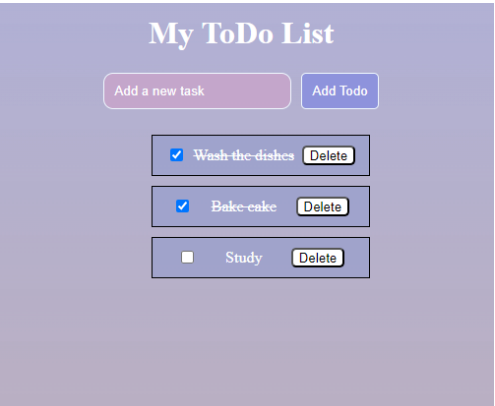

React Практикум 7
Задание 1: Создание Todo приложения с использованием React Context API

1. Настройка проекта
   ○ Создайте новый проект React, используя Create React App.
   ○ Откройте проект в вашей любимой среде разработки.
2. Создание контекста для ToDo приложения
   ○ Создайте файл, например TodosContext.js.
   ○ В этом файле, используйте createContext из React для создания нового
   контекста.
   ○ Определите компонент провайдера, TodosProvider, который будет
   использовать useState для управления состоянием списка задач.
   ○ Добавьте в провайдер методы для управления задачами: добавления,
   удаления и изменения статуса задач.
3. Создание компонентов интерфейса
   ○ Компонент для отображения списка задач (TodoList):
   ● Создайте новый файл, например TodoList.js.
   ● Используйте useContext для доступа к состоянию из
   TodosContext.
   ● Отобразите каждую задачу в списке, добавьте чекбокс и кнопку
   для удаления.
   ○ Компонент для каждой задачи (TodoItem):
   ● Опционально, создайте отдельный компонент для элемента
   списка, если хотите больше контроля над рендерингом каждой
   задачи.
   ○ Компонент для добавления новой задачи (AddTodoForm):
   ● Создайте новый файл, например AddTodoForm.js.
   ● Определите форму с текстовым полем для ввода названия
   задачи и кнопкой для добавления.
   ● Используйте useContext для вызова метода добавления задачи
   из TodosContext.
4. Сборка и запуск приложения
   ○ В файле App.js, используйте TodosProvider для обертывания вашего
   приложения или компонентов, где нужен доступ к задачам.
   ○ Импортируйте и используйте созданные компоненты (TodoList и
   AddTodoForm) внутри App.js.
   ○ Убедитесь, что все необходимые данные передаются корректно, если
   это необходимо.
   ○ Запустите ваше приложение, используя npm start или yarn start, и
   проверьте функциональность в браузере.
5. Стилизуйте получившееся приложение при помощи модульного CSS.
6. Дополнительные улучшения
   ○ Добавьте возможности фильтрации задач (все, активные,
   выполненные).
   ○ Реализуйте сохранение задач между сессиями с помощью localStorage.
   

   Задание 2: Создание системы настройки стилей блога на React с использованием
   Context API

7. Создание контекста - создайте файл BlogSettingsContext.js.
   ○ Импортируйте необходимые зависимости из библиотеки React.
   ○ Создайте контекст с помощью функции createContext().
   ○ Определите провайдер контекста, в котором будет храниться
   состояние для размера шрифта и межстрочного интервала.
   ○ Используйте хуки useState для определения и управления состоянием
   стиля блога.
   ○ Экспортировать функцию useBlogSettings для удобства доступа к
   контексту и упрощения кода в компонентах.
8. Создание компонента настроек (SettingsPanel) - создайте файл
   SettingsPanel.js.
   ○ Импортируйте хук useBlogSettings из созданного контекста.
   ○ Реализуйте интерфейс с выпадающими списками (select) для выбора
   размера шрифта и межстрочного расстояния.
   ○ Пропишите обработчики событий для обновления состояний в
   контексте при изменении значений в элементах формы.
9. Создание компонента для отображения текста (Article) - создайте файл
   Article.js.
   ○ Используйте useBlogSettings для доступа к текущим настройкам из
   контекста.
   ○ Примените настройки стилей напрямую к стилям компонента, обратите
   внимание на правильное применение единиц измерения и других
   стилевых свойств.
10. Сборка и запуск приложения - обновите файл App.js
    ○ Импортируйте BlogSettingsProvider и остальные компоненты
    (SettingsPanel и Article).
    ○ Оберните ваше приложение или часть приложения, где будет
    использоваться стилизация блога, в BlogSettingsProvider для
    обеспечения доступа к контексту.
    ○ Разместите SettingsPanel и Article внутри провайдера для визуализации
    интерфейса настроек и статьи со стилями.
11. Запустите приложение
    ○ Запустите ваше приложение, используя npm start или yarn start, и
    проверьте функциональность в браузере.
12. Стилизация приложения
    ○ Стилизуйте все компоненты вашего приложения при помощи
    модульного css, чтобы придать приятный вид вашему приложению.
