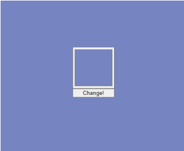
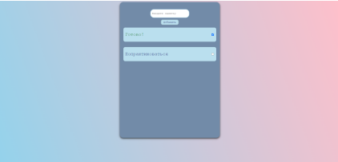

React Практикум 4
Задание 1: Создание простого приложения на React для изменения цвета фона:

1.  Инициализируйте новый проект React с помощью Create React App,
    подготовьте его к работе.
2.  Откройте файл App.js.
3.  Импортируйте хук useState из библиотеки React.
4.  В компоненте, используйте useState для создания состояния color, которое
    будет хранить текущий цвет фона.
5.  Создайте функцию updateColor, которая принимает новый цвет и обновляет
    состояние color.
6.  Внутри JSX компонента App, добавьте стили для вертикального и
    горизонтального выравнивания содержимого и установите фон, используя
    текущее состояние color.
7.  Импортируйте компонент Form и передайте ему функцию updateColor через
    пропсы.
8.  Создайте новый файл Form.jsx в той же директории.
9.  Импортируйте useState так же, как и в App.js.
10. Создайте функциональный компонент Form.
11. Определите состояние newColor для хранения значения цвета, выбранного
    пользователем.
12. Напишите функцию handleChange, которая обновляет newColor на основе
    выбора пользователя.
13. Реализуйте функцию handleSubmit, которая предотвращает стандартное
    поведение формы, и вызывает colorFunction переданную через пропсы из
    App.js, передавая ей newColor.
14. Добавьте элементы управления формой: поле ввода для выбора цвета и
    кнопку для отправки формы.
15. Добавьте базовую стилизацию для формы. Установите дисплей flex и
    направление столбца.
16. Назначьте размеры для поля ввода, чтобы упростить выбор цвета.
17. Сохраните все изменения.
18. В терминале запустите приложение, выполнив команду npm start.
19. В браузере откроется ваше приложение. Попробуйте изменить цвет через
    созданный интерфейс и убедитесь, что цвет фона изменяется соответственно.
    

        Задание 2:
        Написать приложение для управления заметками:

20. Настройте новый проект React с помощью Create React App.
21. Создайте необходимые папки и файлы для вашего проекта: App.js, NoteList.jsx,
    NoteForm.jsx, и Note.jsx. Также создайте папку styles для CSS модулей.
22. Определите CSS модули для каждого компонента (App.module.css,
    NoteList.module.css, NoteForm.module.css, и Note.module.css).
23. Импортируйте стили и компонент NoteList.
24. Создайте базовую разметку, включающую в себя контейнер для NoteList.
25. Импортируйте необходимые зависимости и компоненты (NoteForm и Note), а
    также CSS модуль.
26. Используйте useState для управления списком заметок.
27. Создайте функцию listUpdate, которая добавляет новую заметку в список.
28. Отрендерите NoteForm и передайте ему функцию listUpdate через props.
29. Отобразите все заметки, используя .map() для массива noteList и компонент
    Note для каждой заметки.
30. Импортируйте зависимости и стили.
31. Установите локальное состояние для текста новой заметки.
32. Создайте функцию handleChange, которая обновляет состояние при
    изменении текста в поле ввода.
33. Создайте функцию handleSubmit, которая предотвращает стандартное
    поведение формы, использует колбэк для обновления списка заметок и
    очищает поле ввода.
34. Отрендерите форму с текстовым полем и кнопкой для отправки.
35. Импортируйте зависимости и стили.
36. Инициализируйте состояние для статуса заметки (готово/не готово).
37. Создайте функцию handleChange, которая переключает статус заметки.
38. Отрендерите заметку с условным форматированием для отображения статуса
    и чекбокс для изменения статуса.
39. Стилизуйте созданные компоненты, чтобы придать приятный вид своему
    приложению
40. Проверьте, что приложение корректно добавляет заметки.
41. Проверьте функциональность переключения статуса заметки.
42. Убедитесь, что стили корректно применяются.
    
